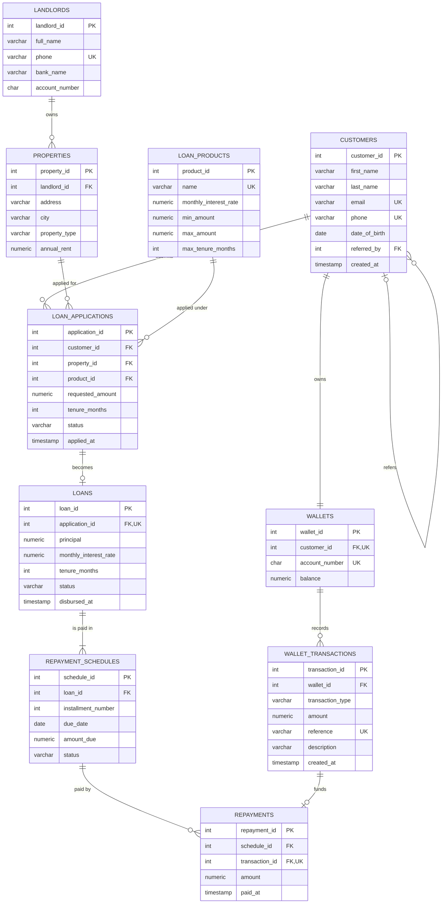

# Portfolio 1: Database Design and Modelling

This activity designs the relational database for RentMadeEasy (see the [main README](../README.md) for the case study).

## Files

| File | Purpose |
|---|---|
| `01_schema.sql` | Creates the 10 tables, keys, constraints and the application check trigger |
| `02_seed.sql` | Inserts sample data: 8 customers, 6 applications, 4 loans and their repayments |

## ER diagram

**Key:** PK = primary key, FK = foreign key, UK = unique.

### Relationships

| Relationship | Type | How it is enforced |
|---|---|---|
| A customer can refer many customers | One-to-many, to itself | `customers.referred_by` references `customers.customer_id` |
| A customer has exactly one wallet | One-to-one | `wallets.customer_id` is a foreign key and `UNIQUE` |
| A wallet has many transactions | One-to-many | `wallet_transactions.wallet_id` foreign key |
| A landlord owns many properties | One-to-many | `properties.landlord_id` foreign key |
| A customer submits many applications | One-to-many | `loan_applications.customer_id` foreign key |
| A property and a loan product can each appear in many applications | One-to-many | `property_id` and `product_id` foreign keys |
| An approved application becomes at most one loan | One-to-one (optional) | `loans.application_id` is a foreign key and `UNIQUE` |
| A loan is paid in many monthly instalments | One-to-many | `repayment_schedules.loan_id` foreign key, `UNIQUE (loan_id, installment_number)` |
| An instalment is paid by one or more repayments | One-to-many | `repayments.schedule_id` foreign key |
| Each repayment is funded by exactly one wallet debit | One-to-one | `repayments.transaction_id` is a foreign key and `UNIQUE` |

`loan_applications` links customers, properties and loan products. It resolves the many-to-many relationship between customers and properties: one customer can apply for several properties over time, and one property can be applied for by different tenants.
