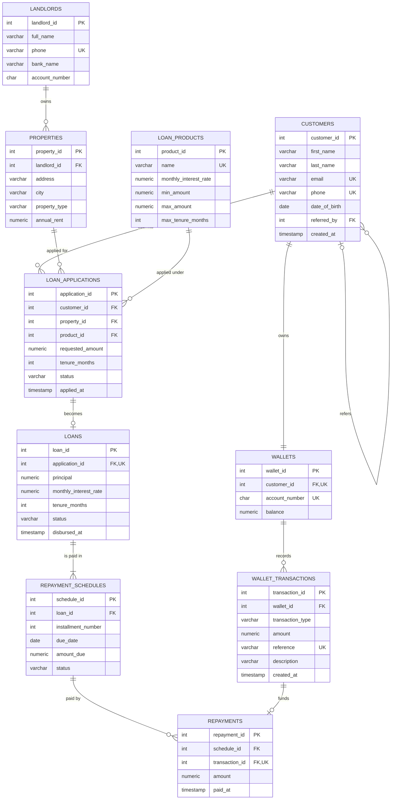

# Portfolio 1: Database Design and Modelling

This activity designs the relational database for RentMadeEasy (see the [main README](../README.md) for the case study).

## Files

| File | Purpose |
|---|---|
| `01_schema.sql` | Creates the 10 tables, keys, constraints and the application check trigger |
| `02_seed.sql` | Inserts sample data: 8 customers, 6 applications, 4 loans and their repayments |

## ER diagram



**Key:** PK = primary key, FK = foreign key, UK = unique.

### Relationships

| Relationship | Type | How it is enforced |
|---|---|---|
| A customer can refer many customers | One-to-many, to itself | `customers.referred_by` references `customers.customer_id` |
| A customer has exactly one wallet | One-to-one | `wallets.customer_id` is a foreign key and `UNIQUE` |
| A wallet has many transactions | One-to-many | `wallet_transactions.wallet_id` foreign key |
| A landlord owns many properties | One-to-many | `properties.landlord_id` foreign key |
| A customer submits many applications | One-to-many | `loan_applications.customer_id` foreign key |
| A property and a loan product can each appear in many applications | One-to-many | `property_id` and `product_id` foreign keys |
| An approved application becomes at most one loan | One-to-one (optional) | `loans.application_id` is a foreign key and `UNIQUE` |
| A loan is paid in many monthly instalments | One-to-many | `repayment_schedules.loan_id` foreign key, `UNIQUE (loan_id, installment_number)` |
| An instalment is paid by one or more repayments | One-to-many | `repayments.schedule_id` foreign key |
| Each repayment is funded by exactly one wallet debit | One-to-one | `repayments.transaction_id` is a foreign key and `UNIQUE` |

`loan_applications` links customers, properties and loan products. It resolves the many-to-many relationship between customers and properties: one customer can apply for several properties over time, and one property can be applied for by different tenants.

## Normalisation

To show why the data is split into these tables, this section starts with how RentMadeEasy might have kept its loan records in a single spreadsheet, then normalises it step by step.

### Unnormalised form (UNF)

One row per loan, with the instalments squeezed into the same row:

| application_id | customer_name | customer_email | property_address | landlord_name | landlord_bank | product | rate | amount | instalments |
|---|---|---|---|---|---|---|---|---|---|
| 1 | Adebayo Ogunleye | adebayo.ogunleye@mail.com | 7 Adeniran Ogunsanya St | Olumide Bakare | Access Bank | Rent Quick | 0.04 | 600,000 | 2026-07-01 224,000 PAID; 2026-08-01 224,000 PAID; 2026-09-01 224,000 PAID |
| 2 | Ngozi Nwosu | ngozi.nwosu@mail.com | 14 Herbert Macaulay Way | Olumide Bakare | Access Bank | Rent Monthly | 0.035 | 900,000 | 2026-08-01 181,500 PAID; 2026-09-01 181,500 PAID; ... |

**Problems:**
- The `instalments` column holds a list. You can't easily query "all overdue instalments" or add up what was paid.
- Olumide Bakare's bank details are repeated for every loan on his properties. If he changes bank, every row must be updated, and missing one leaves the data inconsistent (an **update anomaly**).
- A new landlord can't be recorded until a tenant takes a loan on their property (an **insertion anomaly**).
- If Adebayo's only loan row is deleted, his contact details are lost too (a **deletion anomaly**).

### First normal form (1NF)

**Rule:** every column holds a single value, and there are no repeating groups.

The instalment list is split so each instalment is its own row. The key becomes `(application_id, installment_number)`:

| application_id | installment_number | customer_name | landlord_name | product | rate | amount | due_date | amount_due | status |
|---|---|---|---|---|---|---|---|---|---|
| 1 | 1 | Adebayo Ogunleye | Olumide Bakare | Rent Quick | 0.04 | 600,000 | 2026-07-01 | 224,000 | PAID |
| 1 | 2 | Adebayo Ogunleye | Olumide Bakare | Rent Quick | 0.04 | 600,000 | 2026-08-01 | 224,000 | PAID |
| 1 | 3 | Adebayo Ogunleye | Olumide Bakare | Rent Quick | 0.04 | 600,000 | 2026-09-01 | 224,000 | PAID |

Every value is now single, but the customer, landlord and loan details are repeated on every instalment row.

### Second normal form (2NF)

**Rule:** be in 1NF, and every non-key column must depend on the **whole** key, not just part of it.

With the key `(application_id, installment_number)`:
- `due_date`, `amount_due` and `status` depend on the whole key, because they're different for each instalment.
- `customer_name`, `landlord_name`, `product`, `rate` and `amount` depend only on `application_id`. That is a **partial dependency**.

So the table is split in two:
- **Loan details**, keyed by `application_id`. These become `loan_applications` and `loans`.
- **Instalments**, keyed by `(loan_id, installment_number)`. This becomes `repayment_schedules`.

### Third normal form (3NF)

**Rule:** be in 2NF, and no non-key column may depend on another non-key column (no **transitive dependencies**).

The loan details table still has chains like these:
- `application_id → customer_id → customer_name, email, phone`
- `application_id → property_id → landlord_id → landlord_name, bank_name`
- `application_id → product_id → rate, min_amount, max_amount`

Each chain becomes its own table, linked by a foreign key:

| Dependency removed | New table |
|---|---|
| `customer_id → name, email, phone` | `customers` |
| `property_id → address, rent, landlord_id` | `properties` |
| `landlord_id → name, phone, bank details` | `landlords` |
| `product_id → rate, limits` | `loan_products` |

The wallet, transaction and repayment data is treated the same way: each fact is stored once, in the table whose key it depends on.

All 10 tables are in 3NF. They are also in **Boyce–Codd normal form (BCNF)**, because in every table the only columns that determine other columns are candidate keys: the primary key, or a `UNIQUE` column such as `email` or `reference`.

### Deliberate exceptions

Two columns look like repeated data but are kept on purpose:

**1. `wallets.balance`**

The balance can be worked out by adding up the wallet's credits and subtracting its debits, so strictly it's derived data. It is stored anyway because:
- Checking a balance before every payment would otherwise mean adding up the wallet's whole history each time.
- `CHECK (balance >= 0)` can only stop overdrafts if the balance is an actual column.
- In Portfolio 3, the wallet row is locked while a payment runs, which stops two payments spending the same money at the same time.

The risk is that the stored balance and the transaction history disagree. To prevent that, the balance and the transaction are always written in the same database transaction. This query checks they match:

```sql
SELECT w.wallet_id, w.balance,
       COALESCE(SUM(CASE t.transaction_type WHEN 'CREDIT' THEN t.amount ELSE -t.amount END), 0) AS from_history
FROM wallets w
LEFT JOIN wallet_transactions t ON t.wallet_id = w.wallet_id
GROUP BY w.wallet_id
HAVING w.balance <> COALESCE(SUM(CASE t.transaction_type WHEN 'CREDIT' THEN t.amount ELSE -t.amount END), 0);
```

It returns no rows, meaning every balance matches its history.

**2. `loans.monthly_interest_rate`**

This looks like a copy of `loan_products.monthly_interest_rate`, but it is a different fact: the rate **agreed when the loan was approved**. If RentMadeEasy later raises the Rent Quick rate, existing loans must keep their original rate. So this is not a transitive dependency, and storing it is correct.
