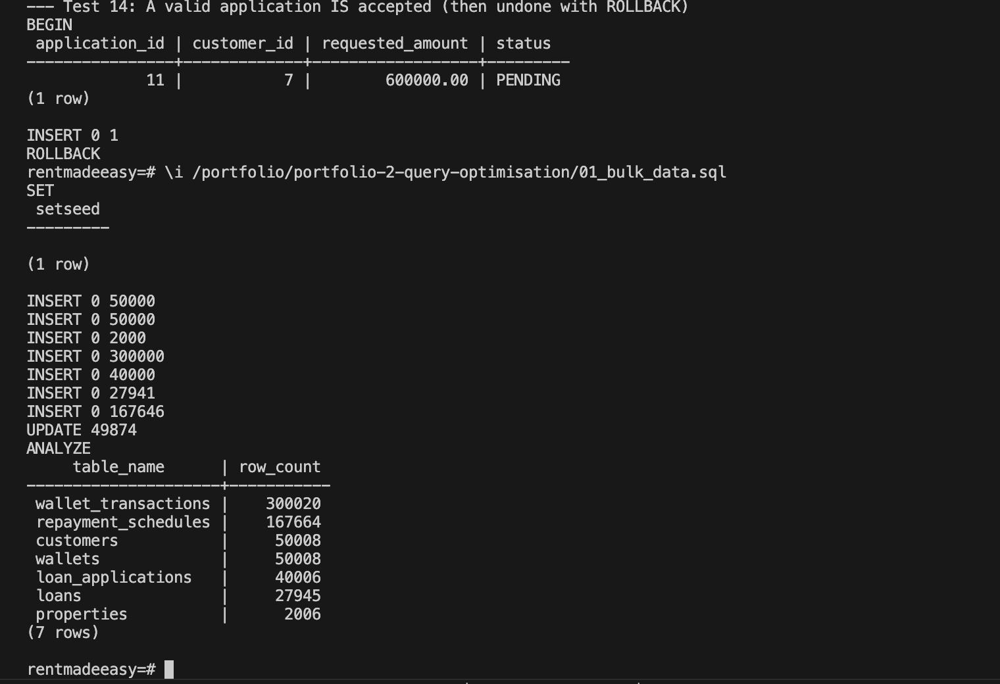
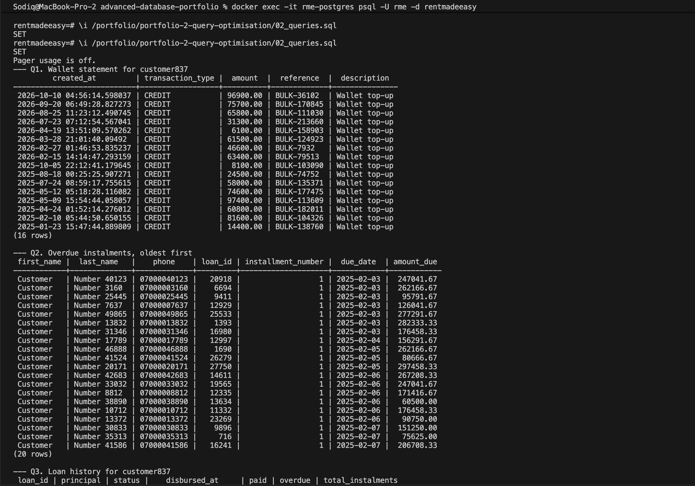
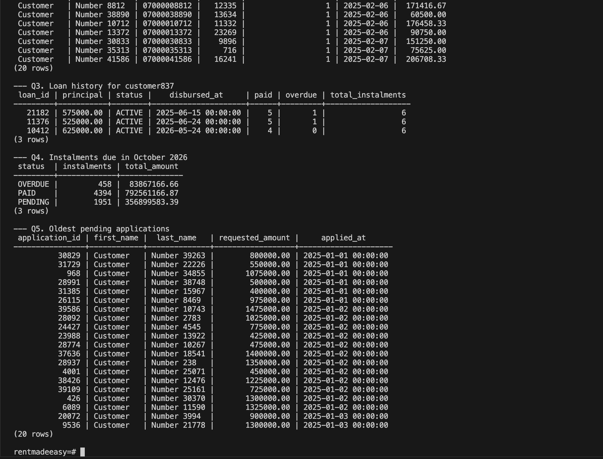
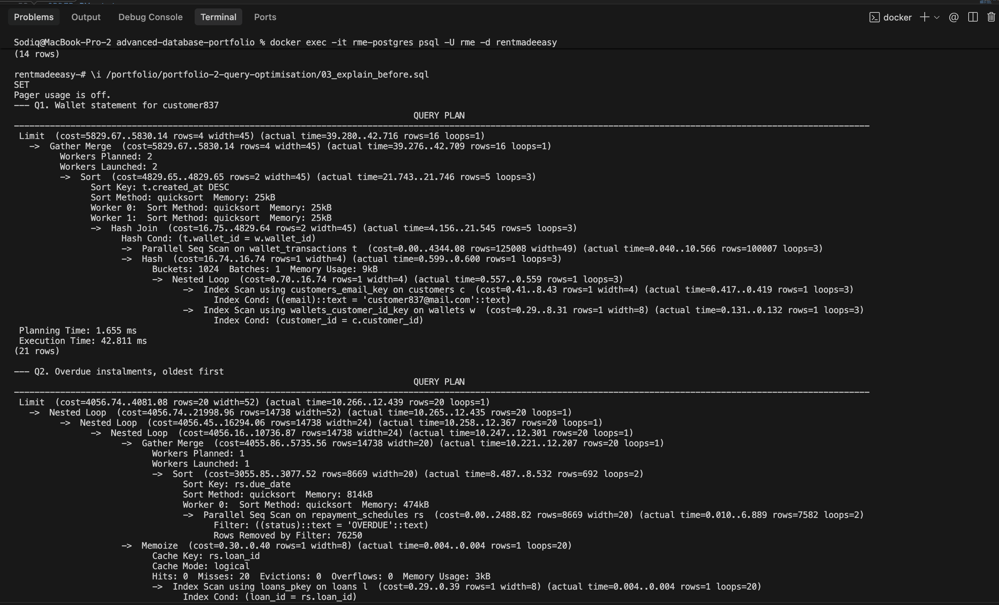
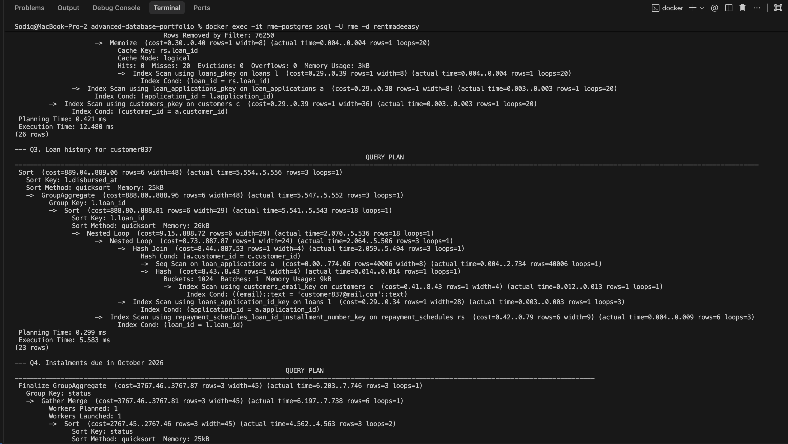
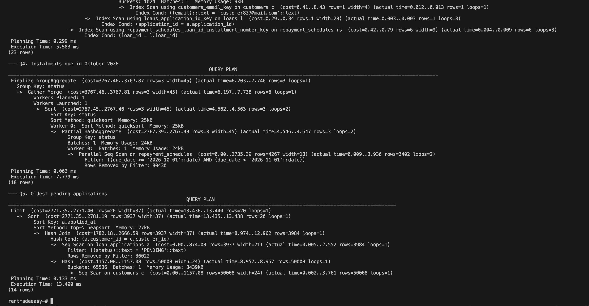
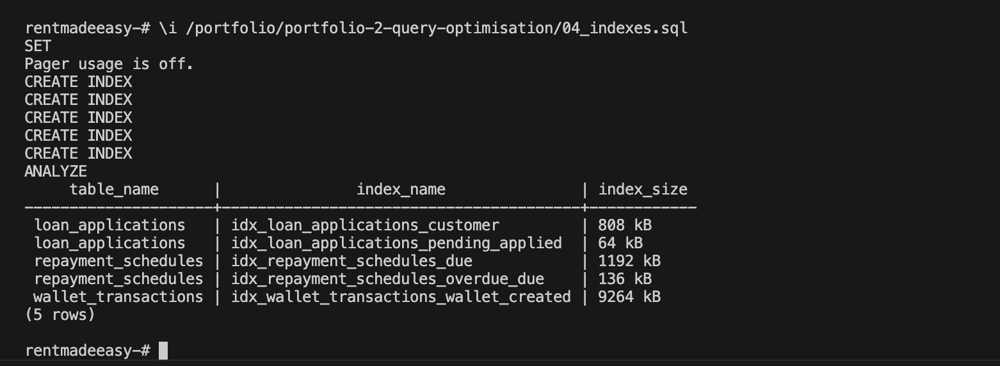
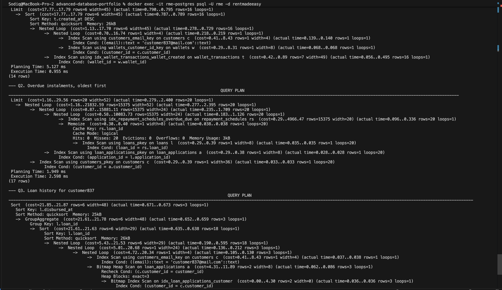
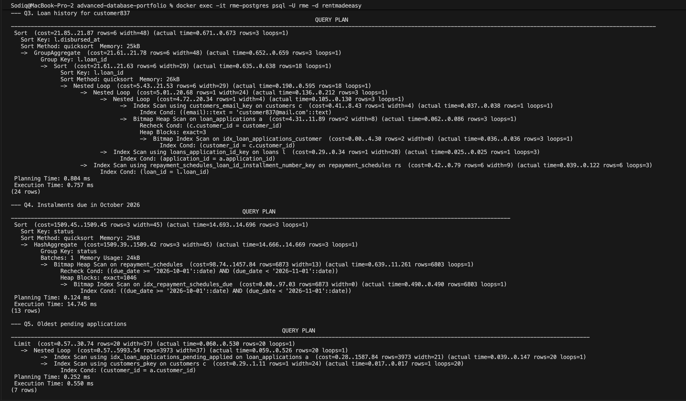

# Portfolio 2: Query Processing and Optimisation

This activity measures five everyday RentMadeEasy queries, finds the slow steps with `EXPLAIN ANALYZE`, adds indexes, and measures them again.

## Files

| File | Purpose |
|---|---|
| `01_bulk_data.sql` | Adds generated test data (50,000 customers, 300,000 wallet transactions) so the differences can be measured |
| `02_queries.sql` | The five business queries and their results |
| `03_explain_before.sql` | Execution plans and times before any new indexes |
| `04_indexes.sql` | Creates five indexes, one for each slow step, and shows their size |
| `05_explain_after.sql` | The same execution plans after the indexes |

### How to run

Run these inside `psql` after the Portfolio 1 files:

```sql
\i /portfolio/portfolio-2-query-optimisation/01_bulk_data.sql
\i /portfolio/portfolio-2-query-optimisation/02_queries.sql
\i /portfolio/portfolio-2-query-optimisation/03_explain_before.sql
\i /portfolio/portfolio-2-query-optimisation/04_indexes.sql
\i /portfolio/portfolio-2-query-optimisation/05_explain_after.sql
```

Run each `explain` file twice and use the second run. The first run also includes the time to read the tables from disk into memory.

## Test data

The 8 customers from Portfolio 1 are too few to show any difference, because PostgreSQL can read a tiny table in one step. `01_bulk_data.sql` uses `generate_series` to add:

| Table | Rows |
|---|---|
| wallet_transactions | 300,020 |
| repayment_schedules | 167,664 |
| customers / wallets | 50,008 |
| loan_applications | 40,006 |
| loans | 27,945 |
| properties | 2,006 |

`setseed(0.42)` makes `random()` give the same numbers every time, so anyone who runs the file gets the same data and can repeat the measurements.

## The five queries

| Query | Used by | What it does |
|---|---|---|
| Q1. Wallet statement | Support | A customer's 20 latest wallet transactions, found by email |
| Q2. Overdue instalments | Collections | The 20 oldest overdue instalments with the customer's phone number |
| Q3. Loan history | Support | Each of a customer's loans with the number of paid and overdue instalments |
| Q4. Due this month | Finance | October 2026 instalments, counted and totalled by status |
| Q5. Review queue | Loan officers | The 20 oldest pending applications |

Q4 uses the range `due_date >= '2026-10-01' AND due_date < '2026-11-01'` instead of `EXTRACT(MONTH FROM due_date) = 10`. Wrapping a column in a function stops PostgreSQL from using a normal index on that column, so the range form was chosen on purpose.

## Plans before indexing

Only primary keys and `UNIQUE` columns had indexes. PostgreSQL does **not** create indexes on foreign keys, so columns such as `wallet_id` and `customer_id` had none.

| Query | Slow step in the plan | Wasted work |
|---|---|---|
| Q1 | Parallel Seq Scan on `wallet_transactions` | About 300,000 rows read to return 16 |
| Q2 | Parallel Seq Scan on `repayment_schedules`, then a sort | About 152,000 rows removed by the filter |
| Q3 | Seq Scan on `loan_applications` | All 40,006 rows read to find 3 |
| Q4 | Parallel Seq Scan on `repayment_schedules` | About 161,000 rows removed by the filter |
| Q5 | Seq Scans on `loan_applications` and all 50,008 `customers`, then a top-N heapsort | About 36,000 rows removed, and every customer read to show 20 |

Some steps were already fast because of indexes that came with the Part 1 constraints. The customer lookup in Q1 and Q3 used `customers_email_key` (from `UNIQUE (email)`). The join to instalments in Q3 used `repayment_schedules_loan_id_installment_number_key` (from `UNIQUE (loan_id, installment_number)`), which works for `loan_id` alone because it is the first column of the index.

## Indexes added

| Index | For | Reason |
|---|---|---|
| `wallet_transactions (wallet_id, created_at)` | Q1 | Finds one wallet's rows already in date order. `wallet_id` comes first because the query searches on it. |
| `repayment_schedules (due_date) WHERE status = 'OVERDUE'` | Q2 | A partial index: it only holds overdue rows, sorted by due date, so the query reads the first 20 and stops. |
| `loan_applications (customer_id)` | Q3 | Indexes the foreign key used in the join. |
| `repayment_schedules (due_date)` | Q4 | For the date range. |
| `loan_applications (applied_at) WHERE status = 'PENDING'` | Q5 | A partial index of pending applications, oldest first. |

`ANALYZE` was run afterwards so the planner had up-to-date statistics.

## Results

Execution times from the second run of each file, on PostgreSQL 16 in Docker on a MacBook Pro:

| Query | Before | After | Change | Plan after indexing |
|---|---|---|---|---|
| Q1 | 42.8 ms | 0.96 ms | About 45 times faster | Index Scan reading 16 rows |
| Q2 | 12.5 ms | 2.6 ms | About 5 times faster | Index Scan that stops after 20 rows, no sort |
| Q3 | 5.6 ms | 0.76 ms | About 7 times faster | Bitmap Index Scan reading 3 rows |
| Q4 | 7.8 ms | 14.7 ms | No improvement | Bitmap Index Scan, but most pages still read |
| Q5 | 13.5 ms | 0.55 ms | About 25 times faster | Index Scan and Nested Loop, `customers` no longer scanned |

The times are small because the whole database fits in memory. The more important measure is how many rows each query reads. Before indexing, Q1 read the whole table, so its time would keep growing as RentMadeEasy adds transactions. After indexing, it reads only the customer's own rows, so its time stays about the same however large the table gets.

## Why Q4 did not improve

The Q4 plan after indexing shows `Heap Blocks: exact=1046`. The `repayment_schedules` table has 1,256 pages, so even with the index PostgreSQL still visited 83% of the table.

The rows were inserted loan by loan, not in date order, so October instalments are spread across almost every page. PostgreSQL measures this in `pg_stats` as the correlation between `due_date` and the physical row order. It is only 0.27 here (1.0 would mean the rows are stored in date order). The index found the 6,803 matching rows in 0.5 ms, but fetching them still meant reading nearly every page, plus the extra work of reading the index.

The lesson is that an index helps when a query needs a small share of the table's **pages**, not just a small share of its rows. For a report like Q4 a sequential scan is already a reasonable plan, and the `idx_repayment_schedules_due` index could be dropped.

## Costs of indexing

Indexes are not free:
- **Storage:** the five indexes use about 11 MB together. The `wallet_transactions` index alone is 9.3 MB, because it has an entry for all 300,000 rows. The two partial indexes are only 64 kB and 136 kB, because they hold only the rows the query needs.
- **Slower writes:** every `INSERT` into `wallet_transactions` now also updates its index. Every change to an instalment's `status` must also update the partial index, adding or removing the row. RentMadeEasy writes wallet transactions all day, so only indexes that a real query needs should be kept.

## Limitations

- The data is generated, so values are spread more evenly than real customer data would be.
- Timings in Docker on a laptop vary from run to run by a few milliseconds, so the plan shapes and row counts are a more reliable comparison than the exact times.
- Q2 orders only by `due_date`, so instalments with the same date can come back in a different order. Adding `rs.loan_id` to the `ORDER BY` would make the order fixed.

## Screenshots

| # | What it shows |
|---|---|
| 01 | Bulk test data loaded, with row counts |
| 02 | Results of the five queries |
| 03 | Execution plans before indexing |
| 04 | The five indexes created, with their sizes |
| 05 | Execution plans after indexing |










