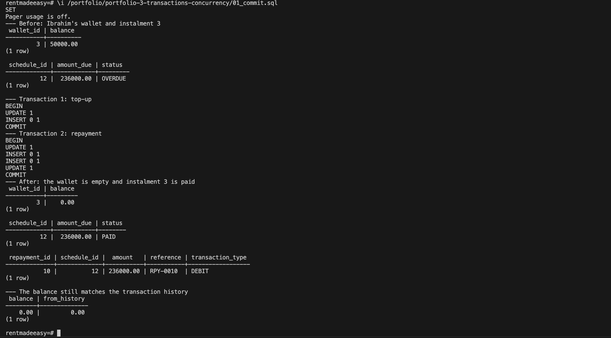
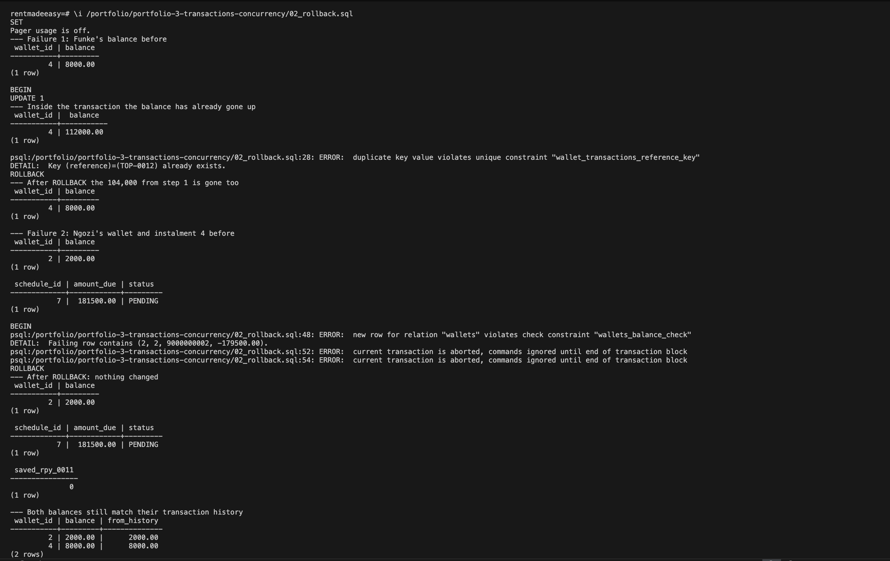
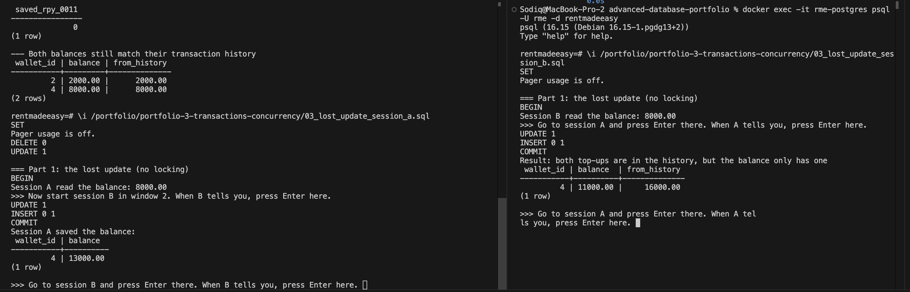
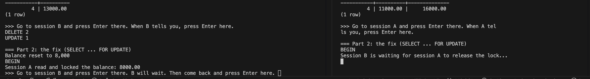
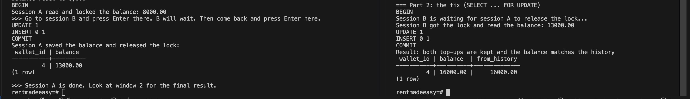
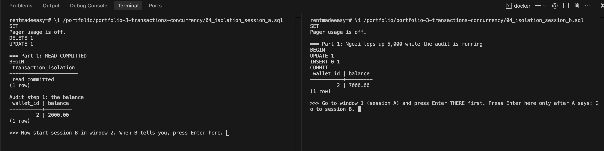
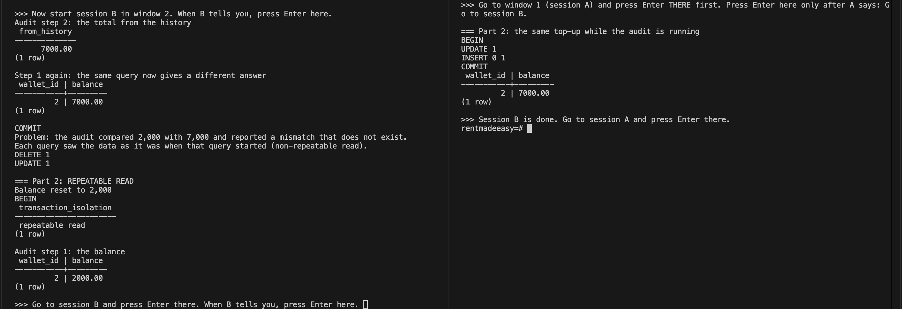
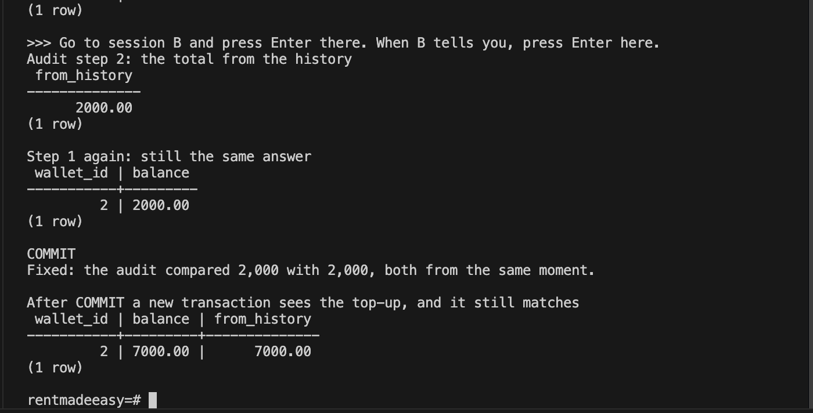

# Portfolio 3: Transactions and Concurrency

This activity shows how PostgreSQL keeps RentMadeEasy's money correct when a payment has several steps, when a step fails, and when two people use the same wallet at the same time. It covers a transaction that commits, transactions that roll back, a concurrency problem (the lost update) and its fix with row locking, and two isolation levels.

Every example uses the Portfolio 1 customers and checks the same rule at the end: **a wallet's balance must equal the total of its transaction history**.

## Files

| File | Purpose |
|---|---|
| `01_commit.sql` | Ibrahim tops up his wallet and pays an overdue instalment, in two transactions that commit |
| `02_rollback.sql` | Two payments that fail part of the way through and are rolled back |
| `03_lost_update_session_a.sql` / `_b.sql` | Two top-ups to the same wallet at the same time: one is lost, then `SELECT ... FOR UPDATE` fixes it |
| `04_isolation_session_a.sql` / `_b.sql` | An audit that runs while a top-up is saved, in `READ COMMITTED` and then in `REPEATABLE READ` |

### How to run

Run these inside `psql` after the Portfolio 1 files:

```sql
\i /portfolio/portfolio-3-transactions-concurrency/01_commit.sql
\i /portfolio/portfolio-3-transactions-concurrency/02_rollback.sql
```

`01_commit.sql` saves its changes, so it can only be run once. To run it again, reload the Portfolio 1 schema and seed first. `02_rollback.sql` saves nothing and can be run any number of times.

Examples 3 and 4 need two sessions at the same time. Open a second terminal with `docker exec -it rme-postgres psql -U rme -d rentmadeeasy`, start the `_session_a` file in window 1, then start the `_session_b` file in window 2 when it says so. Each file stops at `>>>` messages (using psql's `\prompt`) that say which window to press Enter in next, so the steps happen in a fixed order. Both files reset the wallet they use at the start, so they can be run again.

## 1. Commit

Ibrahim (wallet 3) has 50,000 in his wallet but owes 236,000 for his overdue October instalment (schedule 12).

| Transaction | Statements | Why they are grouped |
|---|---|---|
| 1. Top-up of 186,000 | Raise the balance, record a `CREDIT` | The balance and its history must change together |
| 2. Repayment of 236,000 | Lower the balance, record a `DEBIT`, link it in `repayments`, mark the instalment `PAID` | Four tables change. If only some of them changed, money could leave the wallet without the instalment being marked paid. |

**Result:** the balance went from 50,000 to 0.00, the instalment went from `OVERDUE` to `PAID`, repayment 10 was linked to `RPY-0010`, and the balance matched the history (0.00 = 0.00).

This shows **durability**. After `COMMIT`, the changes are saved permanently and are still there after a server restart.

## 2. Rollback

| | What happens | Why it fails | After `ROLLBACK` |
|---|---|---|---|
| **Failure 1: Funke** (wallet 4, 8,000) | The payment provider sends the same top-up twice. The balance is raised to 112,000 first, then recording the top-up fails. | Reference `TOP-0012` already exists, and `reference` is `UNIQUE` | The balance is back to 8,000. The update that had already worked was undone too. |
| **Failure 2: Ngozi** (wallet 2, 2,000) | She tries to pay instalment 4 of 181,500 | The balance would become −179,500, which breaks `CHECK (balance >= 0)` | The balance is still 2,000, the instalment is still `PENDING`, and no `RPY-0011` row exists |

In Failure 2 the two statements after the error were refused with `current transaction is aborted, commands ignored until end of transaction block`. Once a statement fails, PostgreSQL will not run anything else in that transaction, so the remaining steps cannot be saved by mistake.

- **Atomicity** (Failure 1): a transaction happens completely or not at all. A change that had already succeeded was undone because a later step failed.
- **Consistency** (Failure 2): a transaction cannot leave the database breaking its own rules. The `CHECK` constraint from Portfolio 1 stopped a negative balance from being saved.

## 3. Concurrency problem: the lost update

Funke has 8,000. Two top-ups arrive at the same moment: 5,000 in session A and 3,000 in session B. Each session does what a typical app does: it reads the balance into a variable (`\gset`), adds its amount, and writes the new total back.

**Part 1: without locking**

| Step | Session A | Session B | Balance saved |
|---|---|---|---|
| 1 | Reads 8,000 | | 8,000 |
| 2 | | Reads 8,000 | 8,000 |
| 3 | Writes 8,000 + 5,000, commits | | 13,000 |
| 4 | | Writes 8,000 + 3,000, commits | **11,000** |

Both top-ups are in the history (16,000), but the balance only includes one of them (11,000). Session B overwrote A's update with a value worked out from an old read, so 5,000 was lost. `READ COMMITTED` does not stop this, because each statement on its own was valid.

**Part 2: with `SELECT ... FOR UPDATE`**

| Step | Session A | Session B | Balance saved |
|---|---|---|---|
| 1 | Reads 8,000 **and locks the row** | | 8,000 |
| 2 | | Tries to read and lock the row, and **waits** | 8,000 |
| 3 | Writes 8,000 + 5,000, commits, releasing the lock | | 13,000 |
| 4 | | Gets the lock, reads **13,000**, writes 13,000 + 3,000, commits | **16,000** |

The balance and the history both equal 16,000. `FOR UPDATE` is **pessimistic locking**: it assumes a conflict will happen and makes the second session wait. The `03-lost-update-waiting` screenshot shows session B stopped at that point.

A single statement such as `UPDATE wallets SET balance = balance + 3000` would not lose the update even without `FOR UPDATE`. PostgreSQL locks the row during the `UPDATE`, and if another transaction changed it first, it waits and then adds to the newest value. The problem only appears when the new value is worked out from an **earlier** read, which is why the read has to lock the row. `01_commit.sql` uses the single-statement form for this reason.

## 4. Isolation levels

A staff member checks that Ngozi's balance (2,000) matches her history. The check is two queries: first the balance, then the total of the history. Between the two queries, session B saves a 5,000 top-up and commits.

| | Step 1: balance | Top-up saved | Step 2: history | Step 1 run again | Outcome |
|---|---|---|---|---|---|
| **`READ COMMITTED`** (the default) | 2,000 | ✓ | 7,000 | 7,000 | Reports a mismatch that does not exist |
| **`REPEATABLE READ`** | 2,000 | ✓ | 2,000 | 2,000 | Correct: both values come from the same moment |

In `READ COMMITTED`, each **query** sees the data as it was when that query started, so a query run twice in one transaction can return different answers. This is a **non-repeatable read**. In `REPEATABLE READ`, the whole **transaction** sees a snapshot taken at its first query, so all of the audit's queries agree. After the audit committed, a new query saw the top-up, and the balance and history matched at 7,000.

This shows **isolation**: a transaction is protected from changes that other transactions save while it is running.

What each level allows in PostgreSQL:

| Level | Dirty read | Non-repeatable read | Phantom read |
|---|---|---|---|
| Read uncommitted | Not possible in PostgreSQL | Possible | Possible |
| Read committed (default) | Not possible | Possible (shown in Part 1) | Possible |
| Repeatable read | Not possible | Not possible (shown in Part 2) | Not possible in PostgreSQL |
| Serializable | Not possible | Not possible | Not possible |

PostgreSQL is stricter than the SQL standard. It treats `READ UNCOMMITTED` as `READ COMMITTED`, and its `REPEATABLE READ` also prevents phantom reads.

## Choosing between them

| Situation at RentMadeEasy | Approach | Reason |
|---|---|---|
| A top-up or repayment that changes one balance | One `UPDATE ... SET balance = balance + amount` | Safe on its own, with no extra locking |
| A payment where the app must read the balance first, for example to check there is enough money | `SELECT ... FOR UPDATE`, then the update | Stops the lost update. Other payments on the same wallet wait, but only for a few milliseconds. |
| An audit or report that runs several queries | `REPEATABLE READ` | All of the queries see the same moment, so totals agree |

`REPEATABLE READ` is not used for everything because a transaction that **writes** in this level fails with `could not serialize access due to concurrent update` if another transaction changed the same row first, and the app then has to retry it. That is useful for reports, which only read, but it would make busy payment transactions fail and retry often.

## ACID summary

| Property | Shown in |
|---|---|
| Atomicity | 2. Rollback, Failure 1: the balance update was undone when recording the top-up failed |
| Consistency | 2. Rollback, Failure 2: the `CHECK` constraint blocked a negative balance. Every example ends with the balance matching the history. |
| Isolation | 3. Lost update, and 4. Isolation levels |
| Durability | 1. Commit: the changes stay saved after `COMMIT` |

## Limitations

- The two-session examples use `\prompt` to control the order of steps. In a real app the timing is random, so a lost update happens only now and then, which makes it hard to find in testing. That is why the fix should be in the code rather than relying on luck.
- Only the locking fix (`FOR UPDATE`) was demonstrated for the lost update. Running the same transactions in `REPEATABLE READ` would also prevent it, by making session B fail and retry instead of wait.
- After examples 3 and 4, Funke's balance is 16,000 and Ngozi's is 7,000, with the matching top-ups kept in the history. Both files reset these wallets at the start, so they can be run again.

## Screenshots

| # | What it shows |
|---|---|
| 01 | The commit example: before and after, and the balance matching the history |
| 02 | Both rollback failures, with the errors and the unchanged data |
| 03 | The lost update (Part 1), session B waiting for the lock, and the fixed result (Part 2) |
| 04 | The audit in `READ COMMITTED` and `REPEATABLE READ` |









