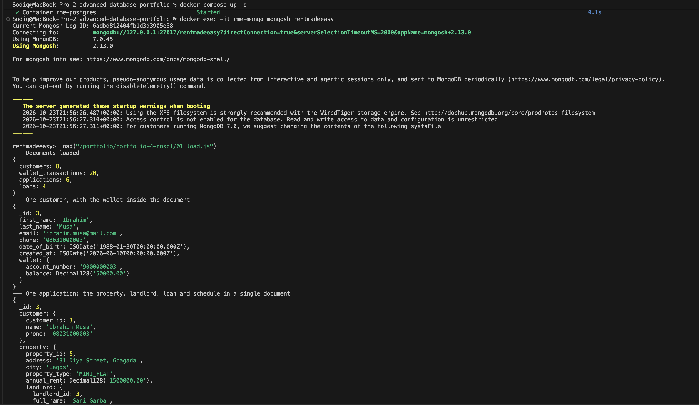
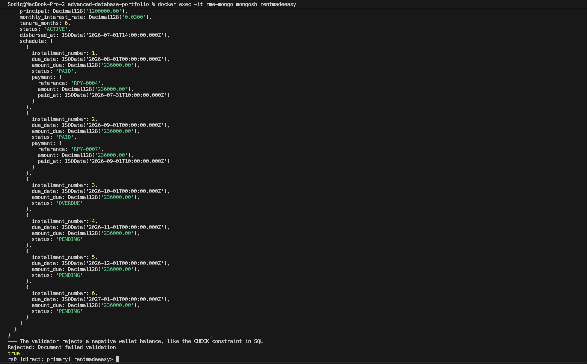
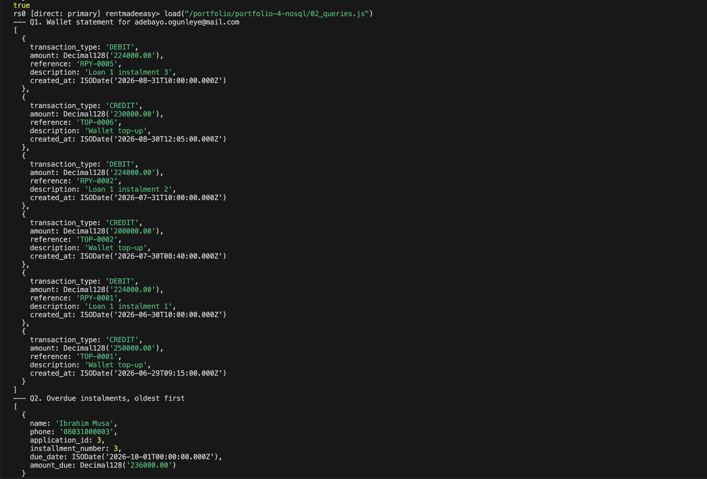
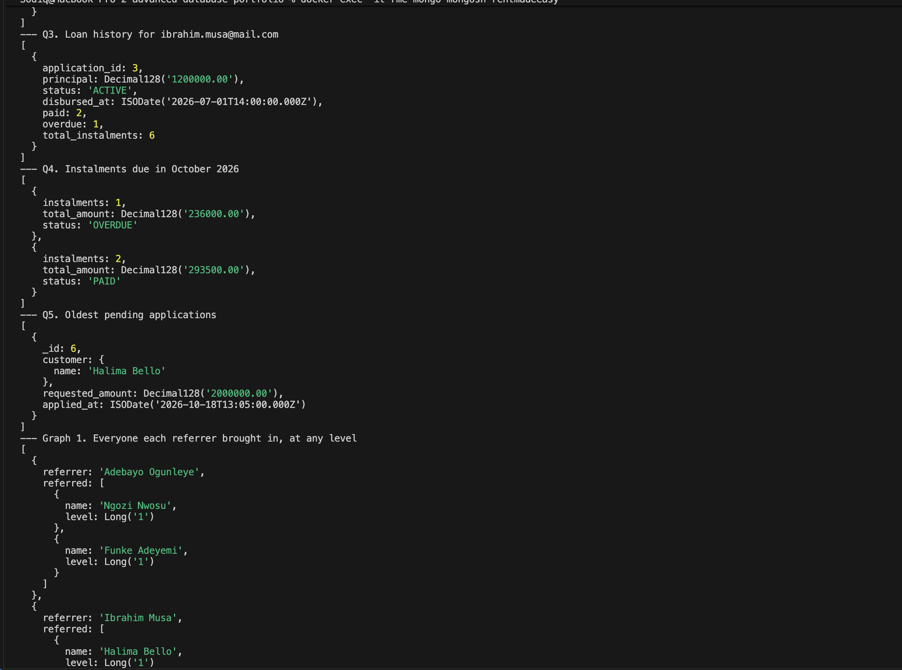
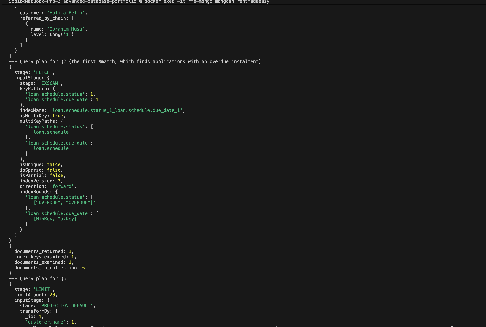
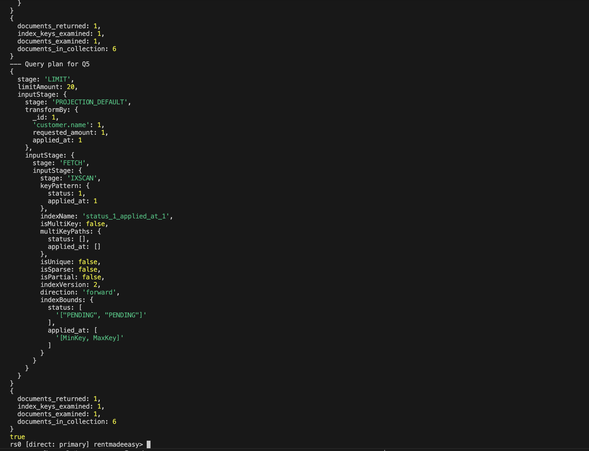
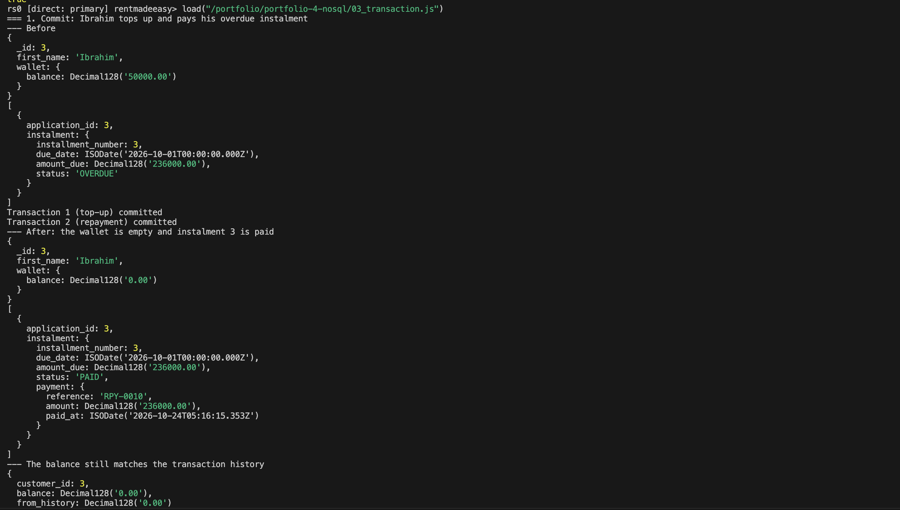
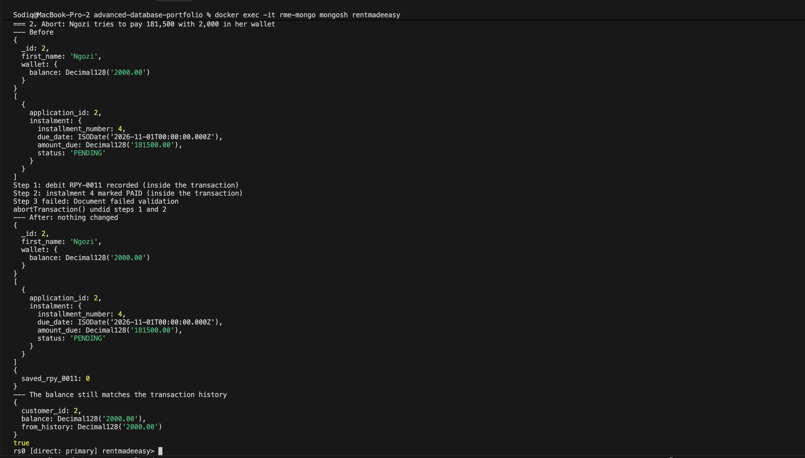

# Portfolio 4: NoSQL and Advanced Data Models

This activity models RentMadeEasy in **MongoDB**, a document database, using the same data as Portfolio 1. It runs the five Portfolio 2 queries against the new model, adds a graph query on the referral network, shows payments as MongoDB transactions, and explains which parts of RentMadeEasy suit a document database and which should stay in PostgreSQL.

## Files

| File | Purpose |
|---|---|
| `01_load.js` | Creates three collections with validation rules and indexes, and loads the Portfolio 1 data as documents |
| `02_queries.js` | The five Portfolio 2 queries in MongoDB, two referral graph queries, and two query plans |
| `03_transaction.js` | A payment that commits and a payment that is aborted, as multi-document transactions |

### How to run

MongoDB 7.0 runs in Docker next to PostgreSQL (see `docker-compose.yml` in the main folder). It is started as a one-node **replica set**, because MongoDB only allows transactions across several documents on a replica set.

```bash
docker compose up -d
docker exec -it rme-mongo mongosh rentmadeeasy
```

Then inside `mongosh`:

```js
load("/portfolio/portfolio-4-nosql/01_load.js")
load("/portfolio/portfolio-4-nosql/02_queries.js")
load("/portfolio/portfolio-4-nosql/03_transaction.js")
```

`01_load.js` drops and reloads the collections, so it can be run again. It also starts the replica set the first time it runs. `03_transaction.js` resets Ibrahim's wallet and instalment at the start, so it can be run again too.

## The document model

Portfolio 1 has 10 tables. In MongoDB the same data is stored in 3 collections:

| Collection | One document is | Holds the data from these SQL tables |
|---|---|---|
| `customers` (8) | A customer, with their wallet inside | `customers`, `wallets` |
| `wallet_transactions` (20) | One credit or debit | `wallet_transactions` |
| `applications` (6) | A rent application. An approved one holds its loan, and the loan holds its schedule and payments. | `loan_applications`, `loans`, `repayment_schedules`, `repayments`, plus copies of `properties`, `landlords` and `loan_products` |

A shortened application document (Ibrahim's loan, before Portfolio 3's payment):

```js
{
  _id: 3,
  customer: { customer_id: 3, name: "Ibrahim Musa", phone: "08031000003" },
  property: {
    property_id: 5, address: "31 Diya Street, Gbagada", annual_rent: Decimal128("1500000.00"),
    landlord: { landlord_id: 3, full_name: "Sani Garba", bank_name: "First Bank", ... }
  },
  product: { product_id: 3, name: "Rent Premium", monthly_interest_rate: Decimal128("0.0300") },
  requested_amount: Decimal128("1200000.00"), tenure_months: 6, status: "APPROVED",
  loan: {
    principal: Decimal128("1200000.00"), status: "ACTIVE",
    schedule: [
      { installment_number: 1, due_date: ISODate("2026-08-01"), amount_due: Decimal128("236000.00"), status: "PAID",
        payment: { reference: "RPY-0004", amount: Decimal128("236000.00"), paid_at: ISODate("2026-07-31T10:00") } },
      { installment_number: 3, due_date: ISODate("2026-10-01"), amount_due: Decimal128("236000.00"), status: "OVERDUE" },
      ...
    ]
  }
}
```

### Embed or reference

In a document database the main design decision is whether related data goes **inside** a document (embedded) or in **another collection** with an ID pointing to it (referenced).

| Data | Choice | Reason |
|---|---|---|
| Wallet in the customer | Embedded | Each customer has exactly one wallet, and they are always read together |
| Schedule in the loan | Embedded | A schedule has at most 12 instalments (the validator enforces `maxItems: 12`), and it is always read and updated with its loan |
| Payment in the instalment | Embedded | Each instalment is paid once, so the payment is a small part of it |
| Loan in the application | Embedded | Each approved application has exactly one loan |
| Property, landlord and product in the application | Copied in | They are saved as they were on the day of the application, so a later rent increase does not change old loans. The cost is that if a landlord changes their bank details, every application for their properties must be updated. |
| Customer name and phone in the application | Copied in | So staff lists (Q2, Q5) need no join. The cost is that a phone number change must be copied to the customer's applications. |
| Wallet transactions | Referenced, in their own collection | A wallet's history keeps growing (300,000 rows in Portfolio 2's test data), and a MongoDB document cannot be larger than 16 MB. Statements also only need the latest few. |

Copying data (denormalisation) is the opposite of what Portfolio 1's normalisation did. In MongoDB it is a deliberate trade: reads become simpler and faster, but some updates must change several documents.

### Rules and validation

| Rule | PostgreSQL (Portfolio 1) | MongoDB |
|---|---|---|
| Required fields | `NOT NULL` | `required` in the `$jsonSchema` validator |
| Allowed values | `CHECK (status IN (...))` | `enum` |
| No negative balance | `CHECK (balance >= 0)` | `minimum: 0` on `wallet.balance`. The load file tests this, and `03_transaction.js` relies on it. |
| No duplicate email or reference | `UNIQUE` | Unique indexes |
| Exact money | `NUMERIC(14,2)` | `Decimal128` |
| A transaction must belong to a real customer | `FOREIGN KEY` | **Not available.** MongoDB does not check that `customer_id` points to an existing customer. The application code has to. |
| Amount within product limits and not above the rent | Trigger `check_application` | Not added. Because the rent is copied into the application, a validator using `$expr` could compare the two fields without a trigger. |

## Queries compared with Portfolio 2

| Query | Result | PostgreSQL | MongoDB |
|---|---|---|---|
| Q1. Wallet statement (Adebayo) | 6 transactions, newest first | One query joining 3 tables | Two reads: find the customer by email, then their transactions. This is the cost of keeping transactions separate. |
| Q2. Overdue instalments | Ibrahim, instalment 3, 236,000 | Joined 4 tables | No join, because the name and phone are in the application. `$unwind` turns each instalment into its own result. |
| Q3. Loan history (Ibrahim) | 2 paid, 1 overdue, 6 in total | Joined 4 tables with `GROUP BY` | One document. `$filter` and `$size` count the instalments inside it. |
| Q4. Due in October 2026 | OVERDUE: 1 (236,000). PAID: 2 (293,500). | `GROUP BY status` on one table | `$unwind`, then `$group` |
| Q5. Review queue | Halima, 2,000,000 | Joined 2 tables | No join |

In Q2 and Q4 the `$match` comes **before** `$unwind`, so it can use an index to pick only the applications that contain a matching instalment. A second `$match` after `$unwind` then keeps only the matching instalments.

### Query plans

`explain("executionStats")` is MongoDB's version of `EXPLAIN ANALYZE`. Both plans used an index (`IXSCAN`) and examined only 1 of the 6 documents:

| Query | Plan, from the inside out | Index |
|---|---|---|
| Q2 | `IXSCAN` → `FETCH` | `loan.schedule.status_1_loan.schedule.due_date_1` |
| Q5 | `IXSCAN` → `FETCH` → `PROJECTION_DEFAULT` → `LIMIT` | `status_1_applied_at_1` |

The Q2 index is **multikey** (`isMultiKey: true`). The indexed fields are inside the `schedule` array, so MongoDB adds one index entry for each instalment, which is how one index can search inside arrays. The Q5 plan has no `SORT` stage, because the index already keeps pending applications in `applied_at` order, just as the partial index did for Q5 in Portfolio 2.

With only 6 documents these plans show that the indexes are used, not how much faster they are. Portfolio 2's measurements cover performance.

## Graph query: the referral network

Each customer stores who referred them in `referred_by`, so the customers form a graph. `$graphLookup` follows these links:

| Query | Result |
|---|---|
| Everyone each referrer brought in | Adebayo brought in Ngozi and Funke. Ibrahim brought in Halima. |
| The chain above Halima, followed upwards | Ibrahim |

The same `$graphLookup` follows the links as many levels deep as they go, and `depthField` records each level. The sample data only has one level of referrals, so every result is level 1. In PostgreSQL the same query needs `WITH RECURSIVE`. A dedicated graph database such as Neo4j would suit this better if the referral network became large and was queried often, for example to find chains of fraudulent sign-ups.

## Transactions

A change to **one document** is always atomic in MongoDB. A transaction is only needed here because a payment changes three collections: the balance in `customers`, a new debit in `wallet_transactions`, and the instalment in `applications`.

| PostgreSQL (Portfolio 3) | MongoDB |
|---|---|
| `BEGIN` | `session.startTransaction()` |
| `COMMIT` | `session.commitTransaction()` |
| `ROLLBACK` | `session.abortTransaction()` |

**1. Commit.** Ibrahim tops up 186,000 and pays his overdue instalment, the same scenario as Portfolio 3. His balance went from 50,000 to 0.00, and instalment 3 went from `OVERDUE` to `PAID`, with the `RPY-0010` payment stored inside the instalment. The balance matched the history (0.00 = 0.00).

The instalment is updated with `"loan.schedule.$.status"`. The `$` means "the array element that matched the filter", which here is instalment 3.

**2. Abort.** Ngozi tries to pay 181,500 with 2,000. The steps are ordered so that two succeed before the failure:

| Step | Result |
|---|---|
| 1. Record debit `RPY-0011` | Succeeded inside the transaction |
| 2. Mark instalment 4 `PAID` | Succeeded inside the transaction |
| 3. Reduce the balance | Failed: `Document failed validation` (the balance would be −179,500) |

`abortTransaction()` undid steps 1 and 2. Her balance was still 2,000, the instalment was still `PENDING`, no `RPY-0011` existed, and the balance matched the history. This shows atomicity across collections, as Portfolio 3 did in PostgreSQL.

## Suitability for RentMadeEasy

| Part of RentMadeEasy | Better fit | Reason |
|---|---|---|
| Wallets and wallet transactions | **PostgreSQL** | Every payment changes several records that must stay in step, so transactions run all the time. Foreign keys guarantee every transaction belongs to a real wallet. Mistakes here cost real money. |
| Finance and audit reports | **PostgreSQL** | Reports join and total data across customers, loans and payments, which SQL does well. |
| Loan applications and loans | **MongoDB** | An application is read as one whole thing (the customer app's "my loan" screen, or a loan officer reviewing it), which is one document read with no joins. New loan products can add new fields without changing a table. |
| Referral network | MongoDB (`$graphLookup`), or a graph database at a larger scale | The data is a network of links |

**Recommendation:** PostgreSQL should stay RentMadeEasy's main database, because the business is built around money, and money needs strict rules and transactions. MongoDB would suit the loan application documents and the screens that show them. Using both together is called **polyglot persistence**. Its cost is keeping the two databases in step, for example copying each payment's status from PostgreSQL to the application document.

The transactions in `03_transaction.js` show that MongoDB *can* handle payments. However, payments needed a transaction across three collections every time, which removes the document model's main advantage and adds overhead. When nearly every write needs a multi-document transaction, that is a sign the data is relational.

## Limitations

- The data is the 8-customer Portfolio 1 sample. It shows the design and the queries working, but not how the two databases compare on performance at scale.
- The copied property, landlord and customer details can become out of date if the originals change and the copies are not updated.
- The replica set has one node, which is enough for transactions but gives no copies of the data and no failover. Portfolio 5 covers replication.
- `03_transaction.js` uses the current time for new payments, so `paid_at` is different on every run.
- The referral data has only one level, so the graph queries do not show deeper chains.

## Screenshots

| # | What it shows |
|---|---|
| 01 | The collections loaded, a customer document, Ibrahim's full application document, and the validator rejecting a negative balance |
| 02 | The five queries, the two graph queries and the two query plans |
| 03 | The payment that commits and the payment that is aborted |









