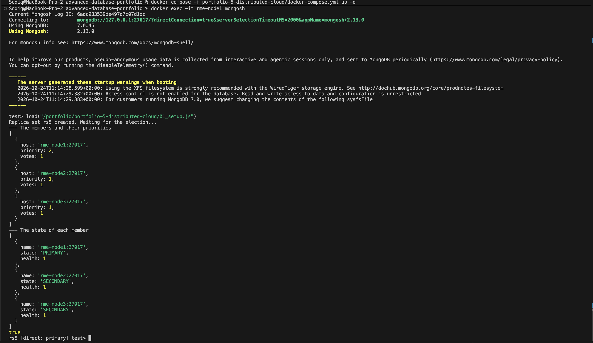
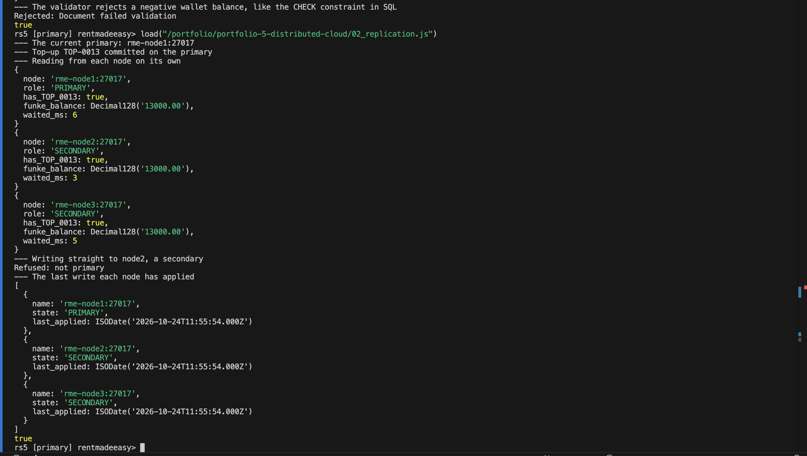
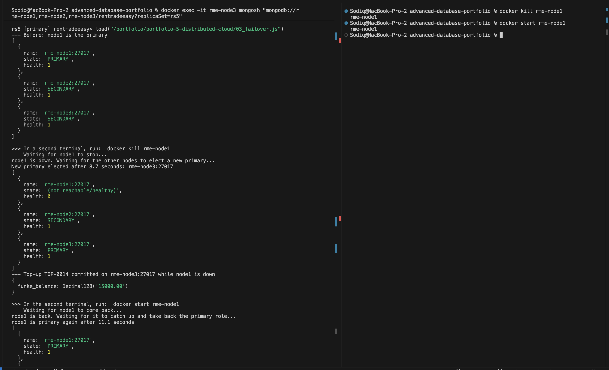
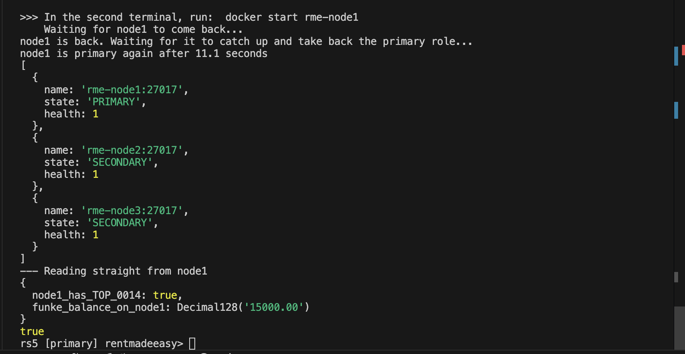
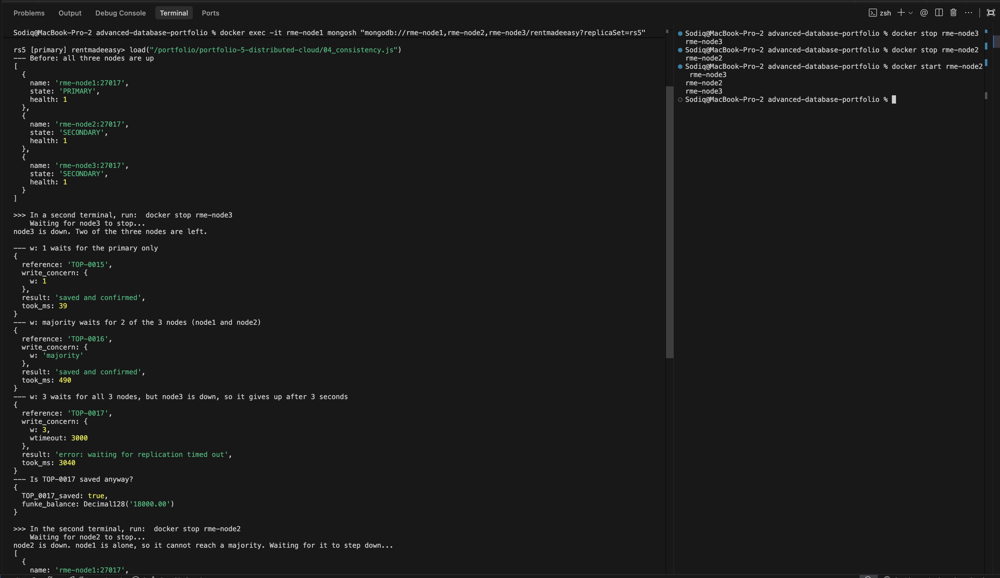
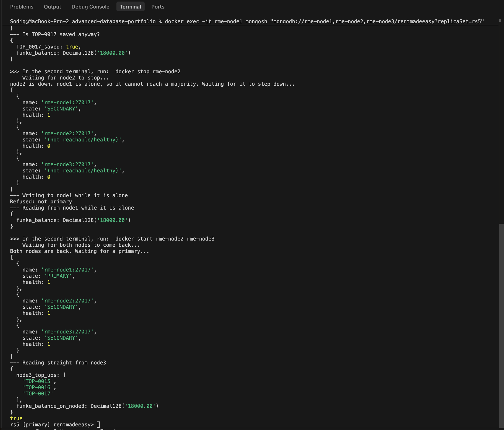

# Portfolio 5: Distributed and Cloud Databases

This activity runs RentMadeEasy's MongoDB database (from Portfolio 4) on **three servers instead of one**, as a replica set. It shows each write being copied to all three servers, the database surviving the loss of its main server, and the trade-off between consistency and availability when servers go down. It ends with how the data could be sharded as RentMadeEasy grows, and how the whole system could be deployed in the cloud.

Every example uses Funke's wallet (customer 4) and checks that all three servers end up with the same data.

## Files

| File | Purpose |
|---|---|
| `docker-compose.yml` | Three MongoDB 7.0 servers, `rme-node1`, `rme-node2` and `rme-node3` |
| `01_setup.js` | Joins the three servers into a replica set called `rs5`, with node1 as the preferred primary |
| `02_replication.js` | A top-up saved on the primary and read back from each server on its own. A secondary refuses a write. |
| `03_failover.js` | The primary crashes, a new primary is elected, a payment still works, and the old primary rejoins |
| `04_consistency.js` | Top-ups saved with three different write concerns while a server is down, then a second server down |

### How to run

Start the three servers from the main portfolio folder:

```bash
docker compose -f portfolio-5-distributed-cloud/docker-compose.yml up -d
```

Set up the replica set by connecting straight to node1:

```bash
docker exec -it rme-node1 mongosh
```

```js
load("/portfolio/portfolio-5-distributed-cloud/01_setup.js")
```

Then exit, connect to the **whole replica set**, and load the Portfolio 4 data:

```bash
docker exec -it rme-node1 mongosh "mongodb://rme-node1,rme-node2,rme-node3/rentmadeeasy?replicaSet=rs5"
```

```js
load("/portfolio/portfolio-4-nosql/01_load.js")
load("/portfolio/portfolio-5-distributed-cloud/02_replication.js")
```

`03_failover.js` and `04_consistency.js` need a second terminal for the `docker` commands that stop and start servers. Each file prints a `>>>` message saying which command to run, and waits until it has happened.

| File | Connect through | Why |
|---|---|---|
| `03_failover.js` | `docker exec -it rme-node3 mongosh "<replica set address>"` | node1 is the one that crashes, and the shell would go down with it |
| `04_consistency.js` | `docker exec -it rme-node1 mongosh "<replica set address>"` | node1 is the one that stays up |

Every file undoes its own top-ups at the start, so it can be run again.

## 1. The replica set

| Server | Role | Priority | Votes |
|---|---|---|---|
| `rme-node1` | Primary | 2 | 1 |
| `rme-node2` | Secondary | 1 | 1 |
| `rme-node3` | Secondary | 1 | 1 |

- The **primary** is the only server that accepts writes. It records every change in its **oplog** (operation log).
- The **secondaries** copy the oplog and replay it, so they hold the same data. This is **replication**.
- The servers check on each other with a **heartbeat** every 2 seconds.
- node1 has a higher **priority**, so it is chosen as primary whenever it is healthy. Each server has one **vote** in elections.

Each Docker container stands in for a server in a different data centre. They find each other by name, the way real servers would by hostname.

## 2. Replication

Funke tops up 5,000 on the primary, with `w: "majority"`. The file then connects to each server **on its own** (`directConnection=true`) and reads the top-up back.

| Server | Role | Has `TOP-0013` | Funke's balance | Waited |
|---|---|---|---|---|
| node1 | Primary | Yes | 13,000 | 3–6 ms |
| node2 | Secondary | Yes | 13,000 | 3–6 ms |
| node3 | Secondary | Yes | 13,000 | 3–6 ms |

- **Every server had a full copy.** All three showed the same last applied time from the oplog, so they were completely in step.
- **Replication is asynchronous.** The primary saves the write first and the secondaries copy it afterwards. Here that took a few milliseconds, because all three servers are on one computer. Across real data centres it takes longer, and while it is happening a secondary can return an older balance.
- **Writing straight to node2 was refused** with `not primary`. Only one server takes writes, so two servers can never save different versions of the same wallet at the same time.

## 3. Failover

node1 is crashed with `docker kill`, which switches it off at once, like a power cut. (`docker stop` shuts MongoDB down politely, and it hands over to another server before switching off. That is a planned handover, not a failure.)

| Step | Result |
|---|---|
| 1. node1 crashes | node2 and node3 stopped getting heartbeats and marked it `(not reachable/healthy)` |
| 2. Election | **node3 was elected primary after 8.7 seconds**, with 2 of the 3 votes |
| 3. A top-up while node1 is down | `TOP-0014` (2,000) committed on node3. Funke's balance is 15,000. |
| 4. node1 is started again | It rejoined as a secondary, copied `TOP-0014` from the oplog, then took the primary role back because of its higher priority. **This took 11.1 seconds.** |
| 5. Reading straight from node1 | `node1_has_TOP_0014: true`, balance 15,000 |

- **High availability:** losing the main server stopped writes for about 9 seconds, not until someone fixed it. A secondary calls an election when it has heard nothing from the primary for 10 seconds (MongoDB's default `electionTimeoutMillis`). The time was measured from when node3 noticed node1 was down, so it is a little under 10.
- **Why three servers:** a new primary needs votes from a **majority** of the set (2 of 3). With only two servers, the one left after a crash would have 1 of 2 votes and could not become primary.
- **No data was lost.** The payment made during the outage was on all three servers once node1 came back.
- **The app did not need to change.** The shell was connected with the replica set address, so it found the new primary by itself. A real app would connect the same way.

## 4. Consistency

### Write concerns

A **write concern** says how many servers must confirm a write before MongoDB reports it as saved. With node3 stopped, Funke tops up 1,000 three times:

| Top-up | Write concern | Waits for | Result | Time |
|---|---|---|---|---|
| `TOP-0015` | `w: 1` | The primary only | Saved and confirmed | 39 ms |
| `TOP-0016` | `w: "majority"` | 2 of 3 servers (node1 and node2) | Saved and confirmed | 490 ms |
| `TOP-0017` | `w: 3`, `wtimeout: 3000` | All 3 servers | **`waiting for replication timed out`** | 3,040 ms |

- **`w: 1` is fastest but can lose data.** If the primary crashes before copying the write, a new primary is elected without it. When the old primary rejoins, it **rolls back** the write, so a payment the customer was told had succeeded disappears.
- **`w: "majority"` cannot be lost.** Any new primary must win votes from a majority, and at least one of those servers already has the write. This is why every payment in Portfolio 5 uses it. It took 490 ms in this run, probably because node3 had only just stopped. In earlier test runs the same write took about 9 ms, so the extra time is the wait for node2 to confirm, and it can vary.
- **`w: 3` failed, but the top-up was still saved** (`TOP_0017_saved: true`, balance 18,000). A write concern error only means that not every server confirmed in time. It does not undo the write. If the app had simply tried again, Funke would have been credited twice. An app has to check whether the payment exists before retrying, for example by its unique `reference`.

### Read concerns and read preferences

These are the read side of the same choice:

| Setting | Options | Meaning |
|---|---|---|
| Read concern | `"local"` (default) | Return the server's latest data, even a write that could still be rolled back |
| | `"majority"` | Return only data that a majority of servers have, so it can never be rolled back |
| Read preference | `primary` (default) | Read from the primary, which always has the latest write |
| | `secondaryPreferred` | Read from a secondary, which takes load off the primary but may be slightly behind |

For RentMadeEasy, wallet balances should be read from the **primary** with `"majority"` before a payment, so a payment is never based on an old balance. Staff reports, such as the overdue list, can read from **secondaries**. A report that is a few milliseconds old does no harm, and it keeps heavy queries away from the server that handles payments.

A separate read concern example was not run. On one computer, copying took 3–6 ms, so `"local"` and `"majority"` reads would have returned the same data.

### Two servers down: the CAP theorem

The **CAP theorem** says that when a network splits (a **partition**), a distributed database must choose between **consistency** (every read gets the latest write, or an error) and **availability** (every request gets an answer, which may be out of date).

node2 was then stopped as well, leaving node1 alone:

| | Result |
|---|---|
| node1's role | It **stepped down** from `PRIMARY` to `SECONDARY` |
| A write to node1 | **`Refused: not primary`** |
| A read from node1 | Still worked. Funke's balance is 18,000. |

node1 cannot tell whether node2 and node3 are switched off or only cut off from it. If they were only cut off, they could elect their own primary and take payments. If node1 also kept taking payments, the two sides would end up with different balances for the same wallet. So MongoDB **chooses consistency for writes**: with no majority, nothing can be written. Reads stay **available**, but may be out of date.

When node2 and node3 were started again, node1 became primary again, and node3 had all three top-ups it had missed (balance 18,000).

**For RentMadeEasy this is the right choice.** Refusing a payment for a few seconds is far better than allowing two different balances, which could let a customer spend the same money twice.

## 5. Sharding

Replication copies **all** the data to every server. It improves availability, but every server still holds everything and the primary still takes every write. **Sharding** splits the data across several replica sets (**shards**), so each one holds and writes only part of it. MongoDB sends each query to the right shard through a router (`mongos`), using a **shard key**.

Sharding was not set up here. With 8 customers there is nothing to split, and a sharded cluster needs at least 3 more servers (config servers and a router). This section is the design for when RentMadeEasy grows.

| Collection | Shard key | Reason |
|---|---|---|
| `wallet_transactions` | `{ customer_id: "hashed" }` | The largest and fastest-growing collection. Hashing spreads customers evenly across shards. All of one customer's transactions are on one shard, so a wallet statement (Q1) only asks one shard. |
| `customers` | `{ _id: "hashed" }` | Spreads customers evenly. Each lookup is for one customer. |
| `applications` | `{ "customer.customer_id": "hashed" }` | A customer's applications are on one shard, so the "my loan" screen only asks one shard |

**Keys that should not be used:**
- **`created_at`** or another value that always increases. Every new transaction would go to the shard holding the newest dates, so one shard would take all the writes.
- **`status`.** It has only a few values, so the data could only be split into a few pieces, and most documents would be `PAID`.

**The cost of sharding:** a query that does not include the shard key must ask **every** shard and combine the results (**scatter-gather**). The overdue list (Q2) and the review queue (Q5) search by status, so they would ask every shard. These are staff reports, run far less often than customer screens, so this is acceptable. They could also be read from secondaries.

**In PostgreSQL**, the same growth is usually handled first by **partitioning** `wallet_transactions` by date range on one server, which makes old months fast to archive. Splitting across servers needs an extension such as **Citus**, with `customer_id` as the distribution column.

## 6. Cloud deployment

This is how RentMadeEasy could run in production, using the recommendation from Portfolio 4 (PostgreSQL for money, MongoDB for application documents):

| Part | Cloud service | Set-up |
|---|---|---|
| PostgreSQL (wallets, payments, reports) | A managed database such as **Amazon RDS** or **Azure Database for PostgreSQL** | **Multi-AZ:** a standby copy in a second data centre (availability zone), kept in step **synchronously**, so no committed payment is lost if the first one fails. Read replicas for reports. |
| MongoDB (applications) | **MongoDB Atlas** | A three-server replica set, one server in each of three availability zones, the same design as this activity. Sharding can be switched on later. |
| Backups | Built into both services | Daily backups with **point-in-time recovery**. Replication is not a backup: if someone deletes a record by mistake, the deletion is copied to every server too. |

**Region:** the nearest large cloud region is in Cape Town or Johannesburg, South Africa. Nigeria's Data Protection Act 2023 has rules about personal data leaving the country, so RentMadeEasy would need to check which data may be stored there, or use a provider with data centres in Lagos.

**What managed cloud databases take care of:** failover, backups, software updates and monitoring. A small fintech does not have to run its own servers, and it pays for the size it needs, growing as it grows.

**What they do not take care of:** choosing the right write concern, read preference and shard key, and handling retries safely. These are decisions in the app's design, as this activity shows.

## Limitations

- All three servers run on one computer. A real replica set would be on separate machines, ideally in separate data centres, where replication takes longer and network partitions really happen. Here a partition was imitated by stopping servers.
- The timings come from single runs on a laptop, and they vary between runs (the `w: "majority"` write took 490 ms here and about 9 ms in earlier test runs).
- Sharding and the cloud deployment were designed, not built. A sharded cluster needs more servers, and a cloud deployment needs a paid account.
- The servers have no passwords and no encryption between them. A real deployment needs both, plus network rules so only the app can reach the database.
- Only MongoDB was distributed in this activity. PostgreSQL replication, such as streaming replication with a standby, was described but not set up.
- After all four files have been run, Funke's balance is 18,000, with top-ups `TOP-0013` to `TOP-0017` in her history.

## Screenshots

| # | What it shows |
|---|---|
| 01 | The replica set created, with the members, priorities and states |
| 02 | The top-up read back from all three servers, the refused write to a secondary, and the oplog times |
| 03 | node1 crashing, the election of node3, the payment during the outage, and node1 coming back as primary with the payment |
| 04 | The three write concerns with node3 down, then node1 stepping down and refusing writes when it is alone, and the recovery |







